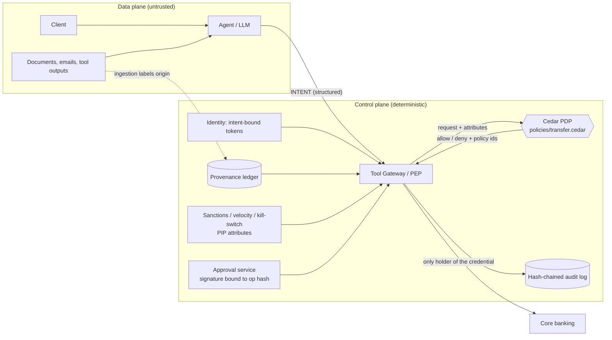

# Architecture

## Principle

> The agent **proposes**. A deterministic control plane **disposes**. No LLM is ever in the authorization loop.

The data plane (LLMs, documents, tool outputs) is assumed hostile. The control plane is small,
deterministic and testable; it is the only thing that can move money.

## Request path (`ToolGateway.transfer`)

1. **AuthN**: verify the token (signature, expiry, revocation). Invalid => deny.
2. **Schema**: exact keys, integer cents, ASCII IBAN, allowed currency. Anything else => deny.
3. **Attributes (PIP)**: provenance of the beneficiary, sanctions, velocity, kill-switch, task bindings from the token
   (source account, payee, currency, cap) and what this token has already spent.
4. **Cedar decision**: default deny; any `forbid` overrides any `permit`. The decision carries the determining policy ids.
5. **Approval**: if the only thing missing is a human, return `PENDING_APPROVAL`; with an approval, verify
   signature, expiry, single use, and that its hash equals the hash of the operation about to execute.
6. **Execute** with the gateway-held credential, charge the amount to the token's budget, then append to the audit
   log (PII tokenised). Steps 1-6 run under a lock so concurrent requests cannot share the same remaining budget.

## Key design decisions

| Decision | Why |
|---|---|
| Intent-bound tokens (source account, payee, currency and a cumulative budget fixed by the trusted request) | Turns confused-deputy, amount manipulation, token replay and split payments into a policy check instead of a detection problem. |
| Provenance labels set by ingestion, default `unknown` => untrusted | An agent cannot launder an attacker-supplied value into a trusted one. |
| Cedar for rules, Python only gathers facts | Policies are reviewable, schema-validated, and mutation-tested independently of the code. |
| Human approves *structured parameters*, signature over the op hash | Defeats misleading LLM summaries and TOCTOU swaps. |
| Fail closed everywhere (evaluation error, malformed approval, unknown provenance) | A broken control must not become an open one. |
